# API2Dev Backup

Backups automáticos agendados para **SQL Server, PostgreSQL, MySQL/MariaDB e Oracle**.
Electron + React + Vite + JavaScript, com banco local **SQLite**.

**API2Dev** · Desenvolvedor: Hendell Cardoso · suporte@api2dev.com.br · WhatsApp (62) 9.9314-8955

[](LICENSE)
[](https://github.com/hendellacardoso/Auto-Backup/releases)

**Download:** [GitHub Releases](https://github.com/hendellacardoso/Auto-Backup/releases) — instalador e versão portátil para Windows 10/11 (64 bits).
Página do projeto: [api2dev.com.br/backup](https://api2dev.com.br/backup)

---

## Recursos

- Conexões com SQL Server (autenticação SQL ou Windows), PostgreSQL, MySQL/MariaDB e Oracle
- Tarefas com **seleção de bancos**, agendamento por **horários fixos + dias da semana** ou **intervalo**
- **Compactação ZIP** com **senha AES-256** (7-Zip embutido)
- **Quantidade máxima de backups por dia** (por banco): ao exceder, os mais antigos do dia são removidos
- **Retenção em dias** (apaga local, Google Drive e FTP)
- Envio para **Google Drive** (OAuth) e **FTP/FTPS**, com opção de não manter cópia local
- **Notificação por e-mail** (nunca / só erro / sempre) com relatório em HTML
- **Histórico** com filtros, log de cada execução, abrir pasta e exclusão
- **Restauração** a partir do histórico (baixa do Drive/FTP se o arquivo local não existir) ou de um arquivo qualquer, com opção de restaurar com outro nome
- Fica na **bandeja do sistema (systray)**, **inicia com o Windows** e pode ser instalado como **serviço do Windows**

## Telas

### Painel
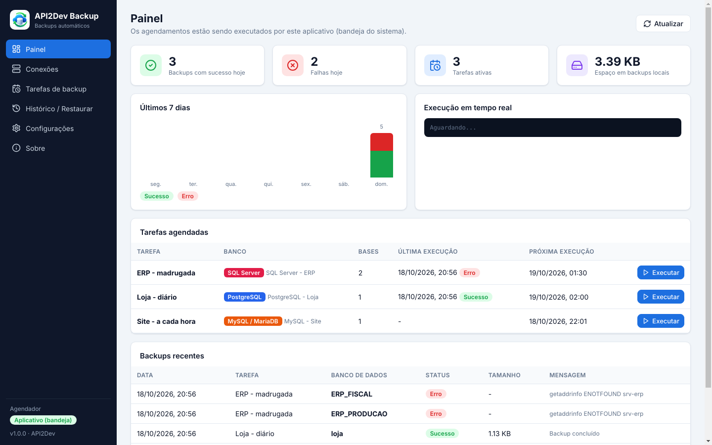

### Conexões
| Lista de conexões | Nova conexão |
|---|---|
| 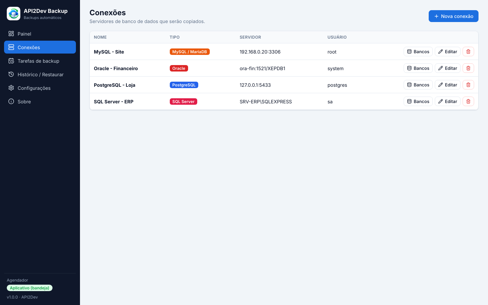 | 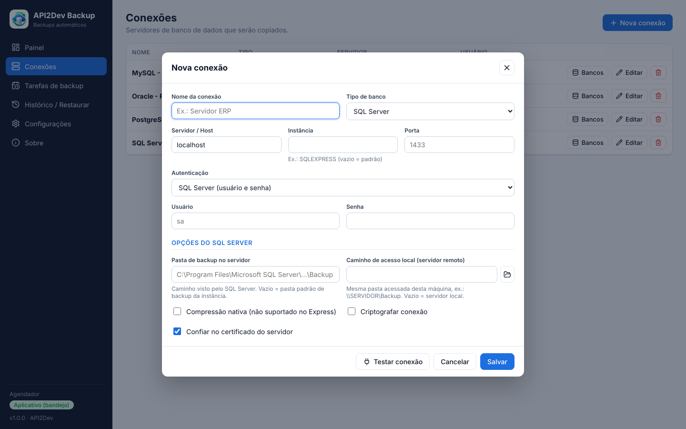 |

### Tarefas de backup
| Lista de tarefas | Edição da tarefa |
|---|---|
| 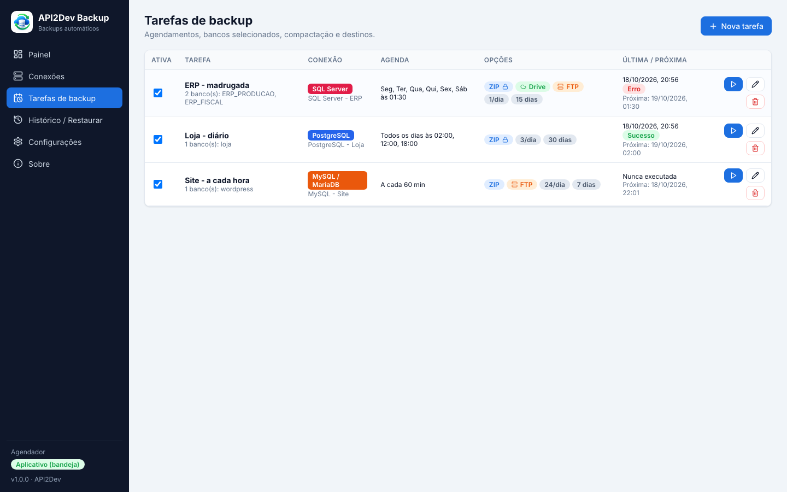 | 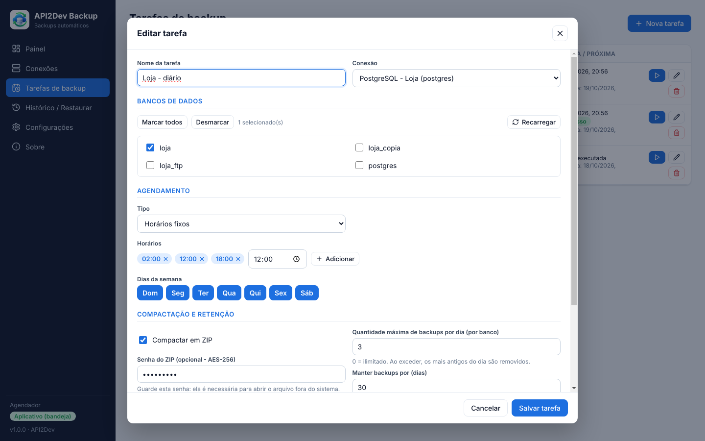 |

### Histórico e restauração
| Histórico | Restaurar backup |
|---|---|
| 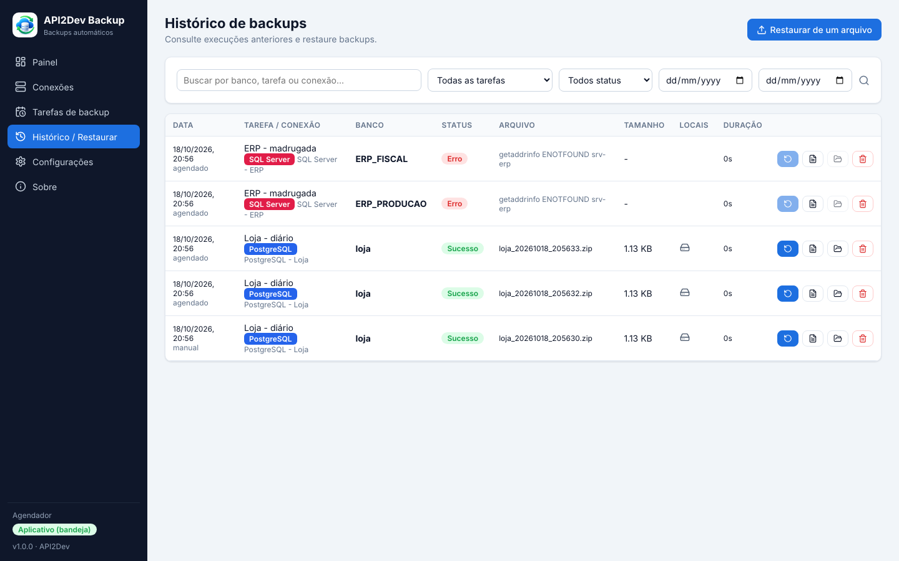 | 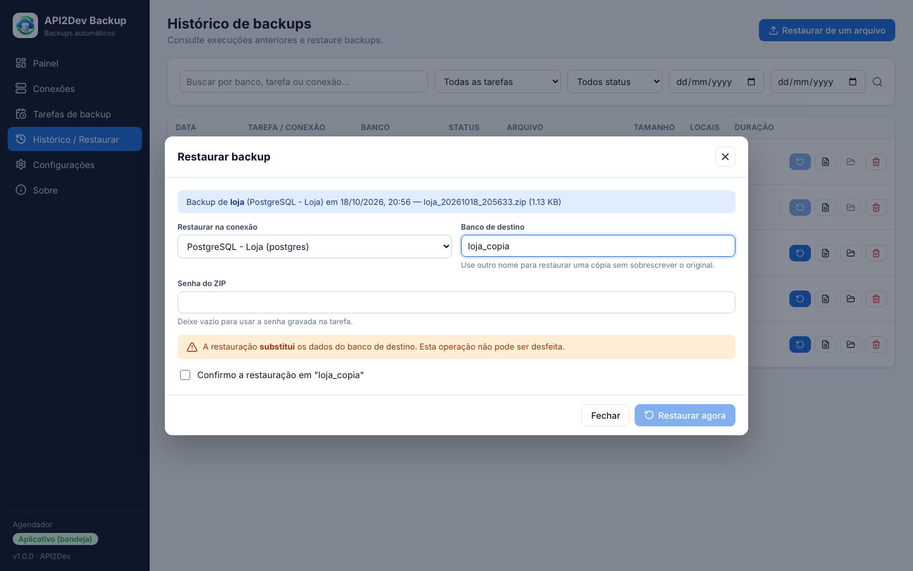 |

### Configurações
| Geral | Serviço do Windows |
|---|---|
| 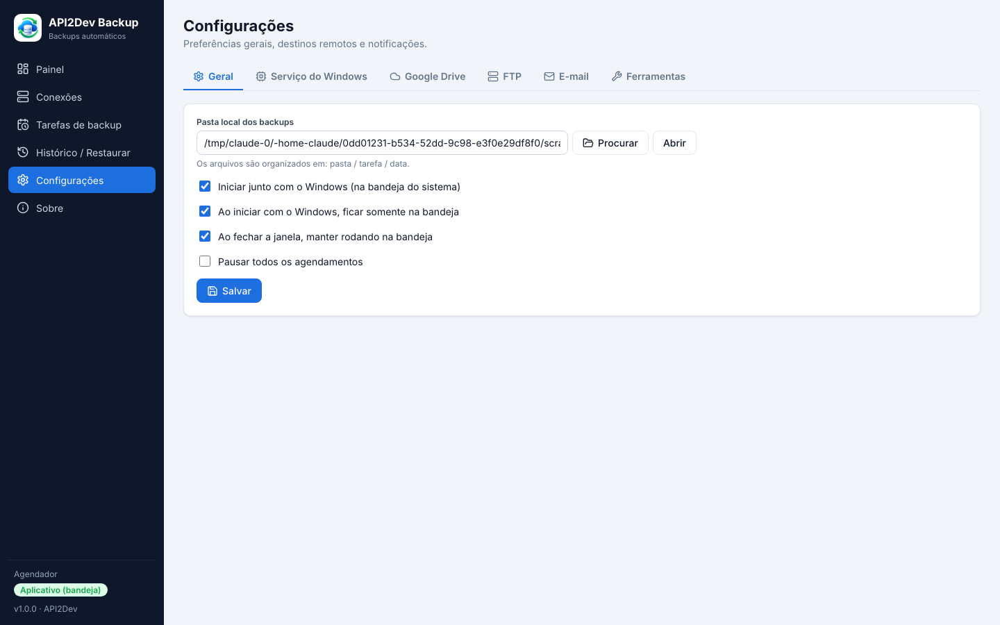 | 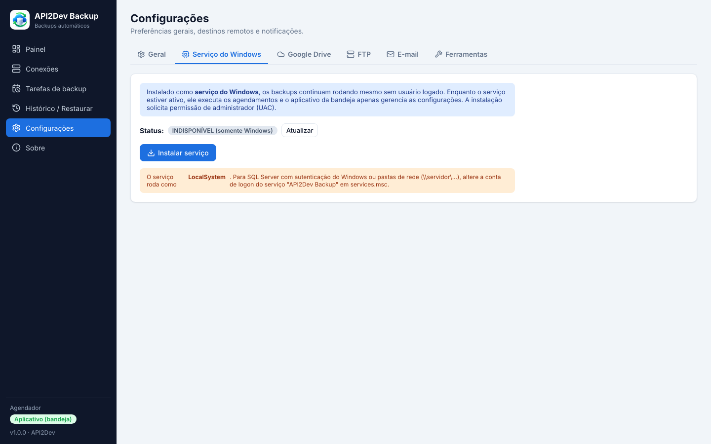 |

| Google Drive | FTP | E-mail |
|---|---|---|
| 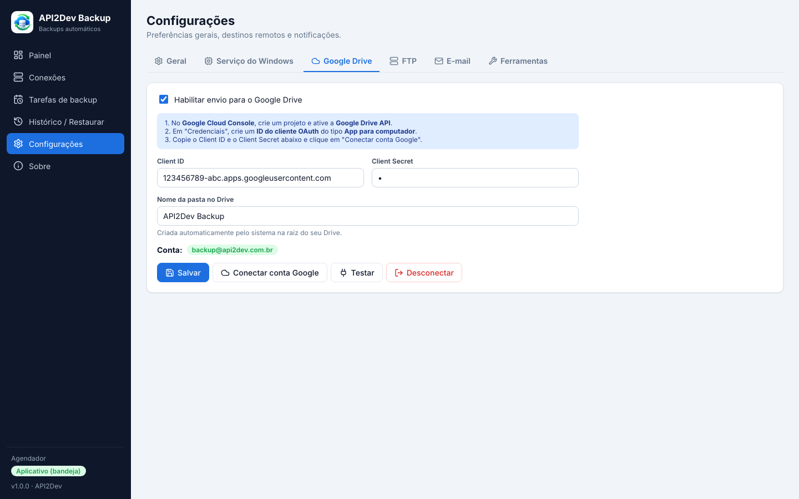 | 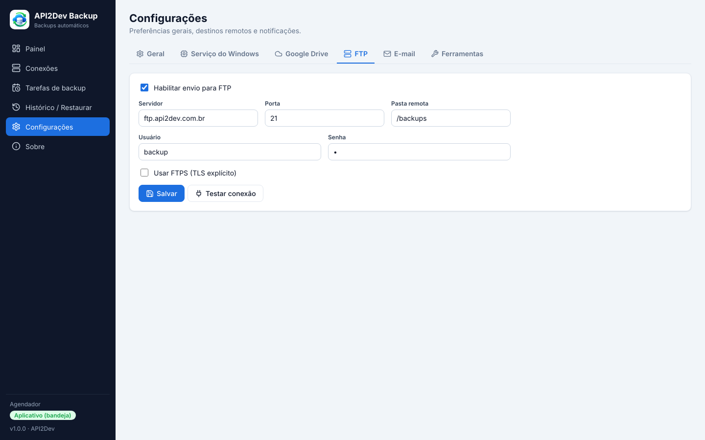 | 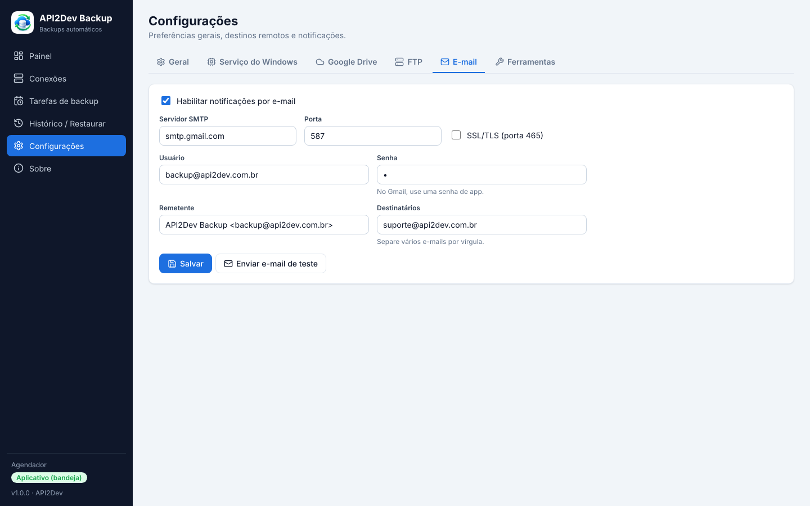 |

## Requisitos

- Node.js 20+ e Windows 10/11 (x64)
- Ferramentas dos bancos na máquina que executa o backup:

| Banco | Backup | Restauração | Observação |
|---|---|---|---|
| SQL Server | `BACKUP DATABASE` (T-SQL) | `RESTORE DATABASE` | Não precisa de ferramentas com usuário/senha. Autenticação Windows usa `sqlcmd`. |
| PostgreSQL | `pg_dump -Fc` | `pg_restore` | Detecta `C:\Program Files\PostgreSQL\*\bin` |
| MySQL/MariaDB | `mysqldump` | `mysql` | Detecta `C:\Program Files\MySQL\MySQL Server *\bin` |
| Oracle | `expdp` (por schema) | `impdp` | Usa o DIRECTORY do Data Pump (padrão `DATA_PUMP_DIR`) |

Os caminhos podem ser definidos em **Configurações > Ferramentas**.

## Desenvolvimento

```bash
npm install          # instala dependências, recompila o better-sqlite3 para o Electron e baixa o WinSW
npm run dev          # Vite (porta 5173) + Electron
```

## Gerar o instalador

Dê duplo clique em um dos arquivos .bat na raiz do projeto (eles rodam `npm install` na primeira vez):

| Arquivo | Gera |
|---|---|
| `gerar-instalador.bat` | `release\API2Dev-Backup-Setup-1.0.0.exe` (instalador NSIS) |
| `gerar-portatil.bat` | `release\API2Dev-Backup-Portatil-1.0.0.exe` (executável único, sem instalação) |
| `gerar-tudo.bat` | os dois |

Ou pela linha de comando: `npm run dist:setup`, `npm run dist:portable` ou `npm run dist`.

### Release no GitHub (com assinatura)

`publicar-release.bat` envia o código e cria a tag `vX.Y.Z`. O GitHub Actions ([`release.yml`](.github/workflows/release.yml))
gera o instalador e o portátil no Windows, assina pela SignPath e publica em [Releases](https://github.com/hendellacardoso/Auto-Backup/releases).
Configuração da assinatura: [docs/SIGNPATH.md](docs/SIGNPATH.md).

A versão portátil roda na bandeja e inicia com o Windows, mas **não instala o serviço do Windows**
(ela é extraída em uma pasta temporária a cada execução). Para usar o serviço, use o instalador.

## Estrutura

```
electron/
  main.js              Janela, bandeja, inicialização com Windows e IPC
  preload.js           Ponte segura (window.api)
  service-manager.js   Instala/remove/inicia/para o serviço (WinSW + UAC)
  service-runner.js    Entrada do serviço do Windows (sem interface)
  core/
    database.js        SQLite: settings, connections, jobs, history
    scheduler.js       Agendador (node-cron + intervalos)
    backup-runner.js   Backup, ZIP, envio, rotação diária, retenção, restauração
    compress.js        ZIP com senha (7-Zip)
    engines/           sqlserver.js, postgres.js, mysql.js, oracle.js
    destinations/      gdrive.js, ftp.js
    notify/email.js    SMTP (nodemailer)
src/                   Interface React (Painel, Conexões, Tarefas, Histórico, Configurações, Sobre)
build/                 Ícones (gerados a partir de icone.png)
resources/service/     WinSW-x64.exe (wrapper do serviço)
```

## Dados

Banco SQLite, logs e backups padrão ficam em `C:\ProgramData\API2Dev\SistemaBackup\`
(compartilhado entre o app da bandeja e o serviço). Senhas são gravadas criptografadas (AES-256-GCM).

## Bandeja x Serviço

- **Sem serviço**: o app da bandeja executa os agendamentos (inicia com o Windows, oculto, via `--hidden`).
- **Com serviço** (Configurações > Serviço do Windows > Instalar): o serviço `API2DevBackup` executa os
  agendamentos mesmo sem usuário logado; o app da bandeja detecta isso automaticamente e passa a apenas gerenciar.
  O serviço roda como LocalSystem — para autenticação Windows no SQL Server ou pastas de rede, altere a conta de logon em `services.msc`.

## Observações por banco

- **SQL Server**: o `.bak` é gravado pelo próprio SQL Server (usa `COPY_ONLY`, não interfere na cadeia de backups).
  Se o servidor for remoto, informe na conexão a *pasta de backup no servidor* e o *caminho de acesso local* (ex.: `\\SERVIDOR\Backup`).
  A conta do serviço do SQL Server precisa ter permissão de escrita nessa pasta.
- **Oracle**: cada item listado é um *schema*. O dump é gerado no DIRECTORY do servidor e movido para a pasta de backups.
- **Google Drive**: crie um *ID do cliente OAuth* do tipo **App para computador** no Google Cloud Console (com a Drive API ativada).
  O app usa o escopo `drive.file` e cria a pasta de destino automaticamente.

## Code signing policy

Free code signing provided by [SignPath.io](https://about.signpath.io/), certificate by [SignPath Foundation](https://signpath.org/).

Os executáveis publicados em [Releases](https://github.com/hendellacardoso/Auto-Backup/releases) são gerados pelo
GitHub Actions ([`.github/workflows/release.yml`](.github/workflows/release.yml)) a partir do código deste repositório e
assinados pela SignPath. Cada pedido de assinatura é aprovado manualmente.

**Team roles / Papéis da equipe**

| Papel | Membros |
|---|---|
| Committers and reviewers (autores e revisores) | [Hendell Cardoso](https://github.com/hendellacardoso) |
| Approvers (aprovadores das assinaturas) | [Hendell Cardoso](https://github.com/hendellacardoso) |

## Privacy policy

This program will not transfer any information to other networked systems unless specifically requested by the user or the person installing or operating it.

O API2Dev Backup não envia dados para a API2Dev nem para terceiros. Ele só se conecta aos sistemas que o próprio usuário
configura: os servidores de banco de dados, o Google Drive (conta autorizada pelo usuário), o servidor FTP e o servidor
de e-mail (SMTP). As configurações e senhas ficam somente no computador, em `C:\ProgramData\API2Dev\SistemaBackup`,
criptografadas.

## Desinstalação

- **Instalador:** Configurações do Windows → Aplicativos → *API2Dev Backup* → Desinstalar (o serviço do Windows, se instalado, é removido junto).
- **Portátil:** feche o programa pela bandeja (*Sair*) e apague o executável.
- Os dados e backups em `C:\ProgramData\API2Dev\SistemaBackup` são mantidos; apague a pasta se não precisar mais deles.

## Licença

[MIT](LICENSE) © 2026 Hendell Cardoso - API2Dev

